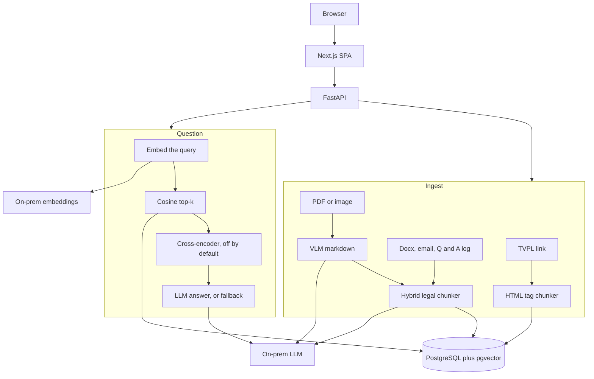

# Legal RAG architecture

The running product is one FastAPI process and a Next.js SPA on PostgreSQL with pgvector. There is no separate queue and no Redis. Ingest and chat run in the request. Files and crawled HTML are stored on the document row. Embeddings live on the chunk row (`Vector(4096)`).

Auth is Azure Entra in the SPA (MSAL). The SPA sends the access token to `POST /auth/session`. The backend checks it and issues its own JWT.

## Ingest

| Entry | What runs |
| --- | --- |
| `upload_link` | `crawl_tvpl_api` only. Law id is the number before `.aspx`. HTML chunker walks `
` and splits only on `<a name="dieu_N">`. Prefix is `[Số: … > Điều N. Title]`. |
| PDF / image | Pages rendered to images, then a vision model, one page at a time. The prompt forces `## Điều`, `### Khoản`, `#### Điểm`, and tells the model not to invent a Điều on a continued page. |
| Dispatch upload | Hybrid chunker (`chunk_with_llm`). |
| General upload | Same hybrid chunker. `process_general` passes the dispatch type, so it does not use the semantic splitter that `chunk()` would pick for `GENERAL`. |
| Email | A separate LLM chunk prompt. |
| Q&A log | Word table parser with fill-down for a merged topic column. |

`upload_link` calls `crawl_tvpl_api` directly. A missing law id or a failed request returns nothing and the link is rejected. `crawl()` would try `web_crawl` (a scrape of `div.content1`) after the API throws, but the upload path does not call `crawl()`. The scrape is unused.

## Question

`POST /chat` loads system config, embeds the query, and takes the nearest chunks by cosine distance (`1 - distance` is the score). Default `top_k` in config is 6.

If `use_rerank` is on, a cross-encoder scores the pairs off the event loop, sigmoid-squashes the logits, drops anything under `relevance_threshold` (default 0.7), and keeps `top_k_rerank` (default 2). The default config has rerank **off**. The default model name is `BAAI/bge-reranker-v2-m3`.

No candidates: the reply is `fallback_answer` (`Xin lỗi, tôi không tìm thấy thông tin cần thiết.` unless the row was edited). Candidates: their text is joined and sent with the system prompt. The prompt requires a citation line of the form document number, điều, khoản, then a quote, then the answer, and it forbids using anything outside the retrieved context.

The reply, the retrieved chunks, and a RAG log row are stored on the session.

## Deprecated / do not use

- `chatbot-pyr-root/AI` (core-knowledgebase, a separate ingestion app, a separate search app, `legal_parser.py`, draw.io named `chatbot_architecture_original`). Not on the request path.
- `splitter.chunk_recursive`. It would emit `[source | Điều N | Khoản M]`. Nothing calls it.
- `web_crawl` and `crawl()`. The link upload does not use them.
- The commented `chunk_dispatch` in `chunk.py` that sent the whole text to one LLM call. The live function is the hybrid loop.
- `chatbot-payroll` and `chatbot-pyr-root/test/`.

## Docs that lag the code

There is no architecture markdown in the backend. These are code-vs-code conflicts:

- `llm.py` defaults the chat model to `gpt-oss-120b`. `system_config.py` defaults `default_llm` to `qwen3:30b-a3b-instruct-2507-q4_K_M`. `POST /chat` uses the request model, which defaults to the `llm.py` value. It does not read `default_llm` from the config row.
- The config row stores `temperature` and `top_p`. `chat_with_llm` ignores them and sends `temperature: 0.1`, `top_p: 0.1`, `reasoning.effort: low`.
- That same client always sends `format: json`. The chunker needs the JSON. The answer prompt asks for Vietnamese prose with a citation. Both calls share the client.
- The default embedding provider is the on-prem LLM (`qwen3-embed-8b`), which matches `Vector(4096)`. `get_embedding_service()`'s own default argument is `LOCAL` (`all-MiniLM-L6-v2`). The singleton uses the on-prem provider. Pointing the singleton at local MiniLM would not match the 4096-d column.
- `search()` returns a bare `[]` when the vector search is empty, and a `RetrievalResponse` otherwise. `chat()` treats a falsy value as the fallback, so the empty case still works.

## Tech stack

### Backend

| Piece | Choice | Source |
| --- | --- | --- |
| Language / runtime | Python 3.12 | `Dockerfile` (`python:3.12-slim`) |
| API | FastAPI, Uvicorn | `requirements.txt`, `Dockerfile` |
| Database | PostgreSQL, SQLAlchemy, asyncpg for requests, psycopg2 for sync | `requirements.txt`, `app/services/db.py` |
| Vectors | pgvector, `Vector(4096)`, cosine distance | `app/models/document.py`, `knowledge.query_async` |
| Schema | `create_all_tables()` plus `run_migrations()` on startup | `app/main.py` |
| LLM and VLM | On-prem LLM, chat completions over HTTP (`httpx`) | `app/services/llm.py` |
| Embeddings | On-prem LLM embeddings, model `qwen3-embed-8b` | `app/services/embedding/` |
| Rerank | `sentence-transformers` `CrossEncoder`, default `BAAI/bge-reranker-v2-m3` | `app/services/search.py` |
| PDF render | pypdfium2 path via `pdf_to_base64` (poppler in the image) | `Dockerfile`, `app/services/util.py` |
| Other files | Docling for non-PDF text, `extract-msg` and the stdlib `email` package for mail | `extract.py` |
| HTML | BeautifulSoup | `crawl.py`, `chunk_html` |
| Auth | MSAL access token in, PyJWT session out, Entra tenant | `app/routers/auth.py` |

### Frontend

| Piece | Choice | Source |
| --- | --- | --- |
| Framework | Next.js 16.0.7 | `package.json` |
| UI | React 19.2.0, TypeScript 5 | `package.json` |
| Styling | Tailwind CSS 4 | `package.json` |
| Auth | `@azure/msal-browser` ^4.27 | `package.json` |
| Answer rendering | `react-markdown`, `remark-gfm` | `package.json` |
| Components | Radix (alert dialog, select, scroll area, collapsible, slot) | `package.json` |

Version string on `GET /api/health` is `0303261615`.
