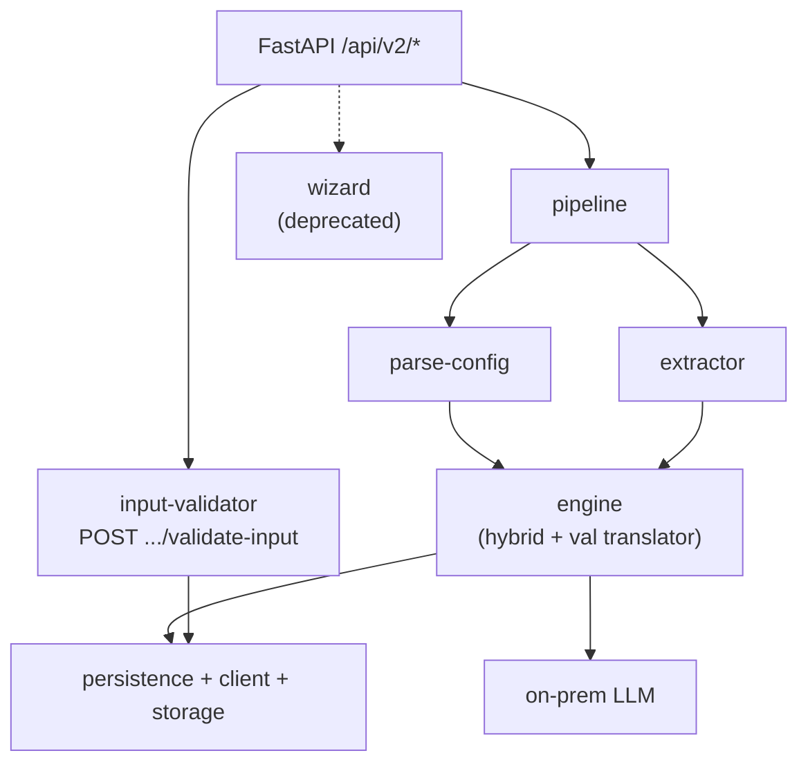
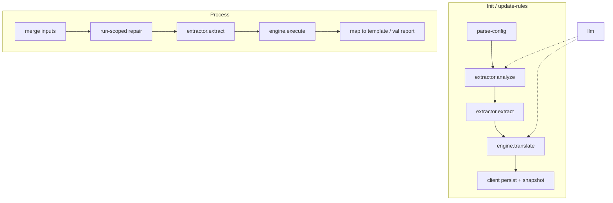

# DVP architecture

DVP is a FastAPI backend plus a Next.js SPA. A client holds a parsed config workbook, extracted sheet structure, compiled calculation and validation rules, and templates. Init and update-rules teach that state. Process runs it on a new month’s Excel or PDF inputs and writes calculated output plus a validation report. Preflight (`POST .../validate-input`) is a sync gate in the UI before process. Process itself does not re-run preflight. It may apply a run-scoped repair overlay that does not mutate the deployed client config. Background work uses an in-process thread pool for init/update-rules and a spawn process pool for `/process`. Files live on local disk under `DATA_DIR` (CephFS PVC in production comments). Auth is Azure SSO in the SPA, exchanged for a backend JWT with RBAC.

Live HTTP for the main path (from `app/routes/processing/` and `app/main.py`):

| Path                                           | Method         | Role                                     |
| ---------------------------------------------- | -------------- | ---------------------------------------- |
| `/api/v2/clients`                              | POST/GET       | Create / list clients                    |
| `/api/v2/clients/{uid}`                        | GET/PUT/DELETE | Client detail                            |
| `/api/v2/clients/{uid}/init`                   | POST           | Analyze + translate (thread pool)        |
| `/api/v2/clients/{uid}/update-rules`           | POST           | Re-translate / refresh rules             |
| `/api/v2/clients/{uid}/validate-input`         | POST           | Preflight (sync, not a ProcessRun)       |
| `/api/v2/clients/{uid}/process`                | POST           | Async process (spawn child → ProcessRun) |
| `/api/v2/clients/{uid}/runs/{id}`              | GET            | Poll status                              |
| `/api/v2/clients/{uid}/runs/{id}/download-zip` | GET            | Results                                  |

Also mounted for the product: auth, admin, dashboard, run-verdict, settings, storage, health. Alias prefixes `/api/v2/processing` and `/api/v2/admin/dashboard` stay mounted but are omitted from OpenAPI. The SPA should use the canonical `/api/v2/clients` and `/api/v2/dashboard` paths.

## Deprecated / do not use

- **Config Workbench (wizard).** Mounted at `/api/v2/wizard-sessions`. Responses carry `Deprecation: true` and `X-DVP-Deprecated: wizard-sessions`. New configuration work uses init and update-rules. Frontend AGENTS.md says the same. Do not describe wizard deploy as the live product path.
- **JSON rule engine.** `EngineType.RULE_ENGINE` remains only so old callers get `ValueError` ("removed"). The live calc engine is Hybrid only. Validation uses `validation_translator` / `validation_rule_engine`, not an `EngineType`.

FLAGS.md and per-folder FINDINGS.md are draft observation notes, not the design. In-package `CONTEXT.md` files often lag the code. Prefer this file plus the architecture tree and the live routers when they disagree.

## Docs that lag the code

Follow the code when these disagree:

- `/Users/phu.mai/Projects/dvp/dvp-backend/README.md` still describes a dual Rule Engine (JSON formulas) plus Hybrid Engine. Live factory is Hybrid only (`/Users/phu.mai/Projects/dvp/dvp-backend/app/services/engine/factory.py`, `/Users/phu.mai/Projects/dvp/dvp-backend/docs/architecture/engine/README.md`).
- Same operator README lists `google-generativeai` in the installed surface and Azure OpenAI as if they were LLM providers. `LLMService` talks to the on-prem LLM over httpx. There is no `google.generativeai` import under `dvp-backend`. Azure OpenAI env vars appear on Settings / `GET /env` but are not read by `LLMService` (`/Users/phu.mai/Projects/dvp/dvp-backend/app/services/llm/service.py`, architecture llm notes).
- Architecture index flowchart still draws wizard as a peer of the live path. Treat it as legacy, dashed, still mounted.

## Tech stack

### Backend

| Piece                 | Choice                                                                                                                                       | Source                                            |
| --------------------- | -------------------------------------------------------------------------------------------------------------------------------------------- | ------------------------------------------------- |
| Language / runtime    | Python 3.11                                                                                                                                  | `Dockerfile` (`python:3.11-slim`)                 |
| Framework             | FastAPI, Uvicorn                                                                                                                             | `requirements.txt`, `Dockerfile` CMD              |
| API version           | `/api/v2`, app `version="2.0.0"`                                                                                                             | `app/main.py`                                     |
| Validation / settings | Pydantic v2, pydantic-settings                                                                                                               | `requirements.txt`                                |
| Database              | PostgreSQL via SQLAlchemy 2.0 (`>=2.0,<2.1`), psycopg2-binary                                                                                | `requirements.txt`, architecture persistence      |
| Migrations            | Alembic                                                                                                                                      | `alembic/`, startup `init_db()`                   |
| Job model             | Init/update-rules: in-process thread pool. Process: spawn process pool + DB-polled cancel. Frontend polls ProcessRun.                        | pipeline README, `job_runtime.py`                 |
| LLM access            | On-prem LLM chat completions (`httpx`), retries, concurrency slot. Default model env `LOCAL_LLM_MODEL`. LangSmith `traceable` on the client. | `app/services/llm/service.py`, `requirements.txt` |
| Rules runtime         | Hybrid NL→Python translator, AST checks, sandboxed execution. Separate validation translator/engine.                                         | `app/services/engine/`                            |
| Workbooks / PDF       | openpyxl, pandas, pdfplumber, msoffcrypto-tool                                                                                               | `requirements.txt`                                |
| Auth                  | Azure Entra SSO in SPA → Graph token → `POST /auth/session` → JWT (PyJWT). Roles admin / owner / member.                                     | architecture auth, `pyjwt`                        |
| File storage          | `LocalFileStorage` under `DATA_DIR`. Production comments describe CephFS at `/data`.                                                         | storage README, `main.py` lifespan                |
| Logging               | loguru                                                                                                                                       | `requirements.txt`                                |

Omit from the main-path story: wizard packages, the removed JSON rule engine, unused `google-generativeai` pin, Azure OpenAI settings that `LLMService` ignores.

### Frontend

| Piece           | Choice                                                                                                                       | Source                             |
| --------------- | ---------------------------------------------------------------------------------------------------------------------------- | ---------------------------------- |
| Framework       | Next.js 16.1.5 App Router                                                                                                    | `package.json`, frontend AGENTS.md |
| UI library      | React 19.2.3, React DOM 19.2.3                                                                                               | `package.json`                     |
| Language        | TypeScript 5                                                                                                                 | `package.json`                     |
| Auth            | `@azure/msal-browser` ^3.30. JWT kept in `localStorage`. Authenticated pages are server shells that mount client components. | `package.json`, AGENTS.md          |
| Data fetching   | SWR ^2.4                                                                                                                     | `package.json`, AGENTS.md          |
| i18n            | next-intl ^4.14                                                                                                              | `package.json`                     |
| Tables / charts | `@tanstack/react-table`, `@tanstack/react-virtual`, recharts                                                                 | `package.json`                     |
| UI kit          | radix-ui / shadcn, lucide-react, Tailwind CSS 4                                                                              | `package.json`                     |
| Node            | `>=24`                                                                                                                       | `package.json` engines             |

API base is `NEXT_PUBLIC_API_URL` → `/api/v2/...`. Generated OpenAPI types live under `types/generated/`.
