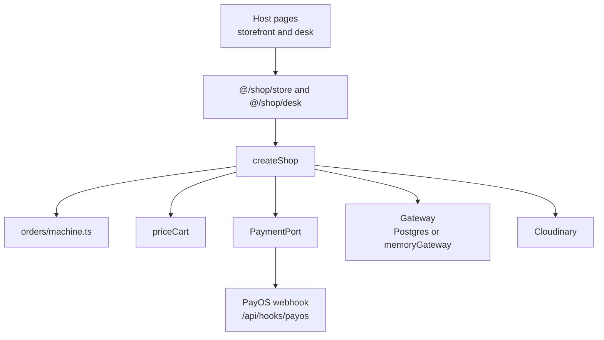

# Ecom architecture

One TypeScript engine, `src/shop`, and a thin host that calls it. The host in this repo is a small Next.js example. Mirror Now is the first real host: a storefront and a seller desk. The next client is another host. The engine stays.

A page imports `@/shop/store` or `@/shop/desk`. It does not import PayOS, Drizzle, Cloudinary, or Neon Auth. `src/shop/boundaries.test.ts` walks `src/shop` and fails if a file imports `next`, `react`, or `@/app`.

Two files are still tied to Next, on purpose, and they are the swap points for another framework:

- `src/shop/auth/neon.ts` uses Neon Auth's Next SDK.
- `src/shop/payments/payos.ts` builds the return URL from `NEXT_PUBLIC_APP_URL`.

`requireBuyer(host)` returns `{ ok: true, value }` or `{ ok: false, reason: "sign_in" | "forbidden" }`. The engine does not redirect. `src/app/auth/host.ts` is the ten-line Next.js adapter that does.

## Money and orders

`priceCart` (`src/shop/pricing/applySaleOffs.ts`) takes a list of discounts. A sale-off is one producer. A coupon appends to that list. Checkout does not grow a branch for each promotion.

A payment provider implements `PaymentPort`: `methods`, `charge`, `verify`, and optional `lookupPaid`. It is registered in `src/shop/payments/registry.ts`. Its webhook is `/api/hooks/<name>`. `placeOrder` and the state machine are not edited to add one.

`src/shop/orders/machine.ts` is a pure step function. `payment_received` is legal only from `awaiting_payment`, and only when the notice amount and order id match. A cancelled order rejects the notice as `unapplied`. Anything else is `illegal`. Cash on delivery is its own status, `collect_on_delivery`: fulfill marks it paid with provider `cod` and writes a receipt. No charge is created. `CHECKOUT_METHODS` chooses which of `payos` and `cod` the buttons offer. PayOS is offered only when its keys are set.

The engine returns error codes. The host turns one into a sentence with `describeError`, or into a redirect with `withError`.

## Storage

`Gateway` is the port. Postgres through Drizzle and `@neondatabase/serverless` is the live one. `memoryGateway()` is another implementation of the same port, used by `npm test` and by `npm run shop -- demo`. The suite does not mock the engine. It runs it.

`scripts/verify-live.ts` runs the same engine against `DATABASE_URL`, forces `CHECKOUT_METHODS=cod`, and deletes what it created.

## Stack

TypeScript. Example host: Next.js 16.3.6, React 19. Database: Postgres, Drizzle 0.45. Auth: Neon Auth, with `ADMIN_EMAILS` granting `admin`. Payments: PayOS 2.0.5. Images: Cloudinary. Tests: Vitest 5.
