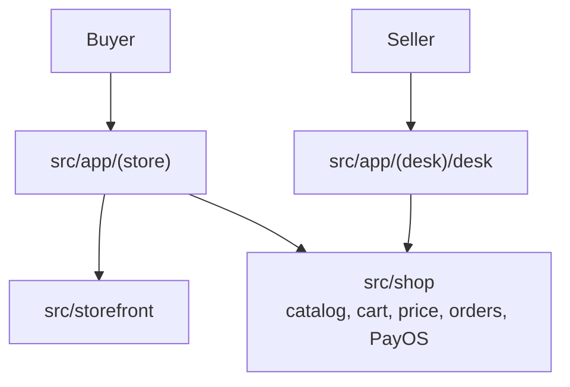

# Mirror Now architecture

Mirror Now is a host for the [Ecom](../architecture.md) engine. It does not replace `src/shop`. The repo still carries its own copy of that tree. The shop-specific code is the Next.js app around it.

`/admin` redirects to `/desk`. The desk layout is not rendered for a buyer.

## Buyer

`src/app/(store)`:

| Path | Page |
| --- | --- |
| `/` | Catalog |
| `/product/[slug]` | One product |
| `/cart` | Cart and checkout |
| `/orders`, `/orders/[id]` | The buyer's orders |

`src/storefront` is the shared presentation: price format, photo, variants, setup, status. Those modules and the store pages import `@/shop/store` and `@/shop/auth`. The look is the variables at the top of `src/app/globals.css`.

## Seller

`src/app/(desk)/desk`:

| Path | Page |
| --- | --- |
| `/desk` | Home of the desk |
| `/desk/products` | Catalog the seller edits |
| `/desk/orders`, `/desk/orders/[id]` | Orders |
| `/desk/sales` | Sales |
| `/desk/events` | Events |
| `/desk/codes` | Codes |

Desk actions call `@/shop/desk`. They do not talk to PayOS or Postgres themselves.

## What stays in the engine

Checkout methods, the PayOS webhook `/api/hooks/payos`, the order step function, and `priceCart` are the template's. A Mirror Now change to a color, a product card, or a desk page does not add a branch to `placeOrder`. Stack matches the template: Next.js 16.3.6, React 19, Tailwind 4, Drizzle, Neon Postgres, Neon Auth, PayOS, Cloudinary, Vitest.
