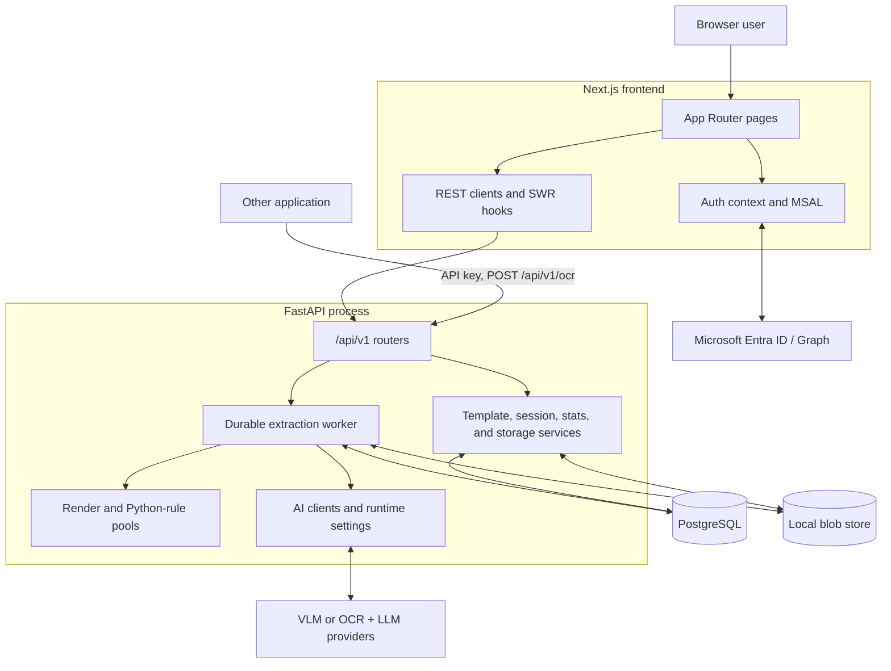

# Document OCR architecture

Runtime version noted in the architecture doc: `2408261708`. Source code and Alembic migrations remain the final authority when the doc disagrees.

## System shape

OCR Platform is two apps on one PostgreSQL database and a local blob store. The Next.js frontend talks to a FastAPI backend over REST (legacy SSE extraction routes remain for compatible clients). The backend process owns CORS, auth, domain services, the render pool, the restricted Python-rule pool, and an in-process durable extraction worker. PostgreSQL is both the system of record and the work queue (`FOR UPDATE SKIP LOCKED`). Redis is not used. Inference is either a direct VLM provider or a hybrid OCR then LLM mapper. Optional Microsoft Entra ID signs users in; the backend issues an application JWT.

## Extraction path

Preferred browser flow (work-unit mode, default on):

1. **Upload.** `POST /api/v1/extract/upload` stages each PDF or image into the local blob store and inserts a `staged_uploads` row. Admission checks size, count, TTL, and queue depth.
2. **Start.** `POST /api/v1/extract/pdfs/start` creates an `extraction_sessions` row, freezes AI runtime settings, preprocessing plan, schema, rules, and prompts on the session, and enqueues `extraction_work_units`. The API returns immediately.
3. **Claim.** The in-process worker fair-claims units from PostgreSQL with `FOR UPDATE SKIP LOCKED`, under pod, user, and session limits.
4. **Render.** Format-specific adapters render the source into normalized page images. Preprocessing splits units as `per_page` (default), `per_source`, or `page_chunks`. With pipeline stages enabled, render and extract use separate capacity pools and a bounded ready queue.
5. **Extract.** The active engine runs:
   - **VLM (default boot setting):** page image → vision-language model → schema-shaped JSON.
   - **Hybrid:** page image → Mistral-compatible OCR → text/markdown → LLM schema mapping → JSON. Hybrid units may also take a native PDF text shortcut when that mode is enabled in config (see Docs that lag the code).
6. **Rules.** Compiled post-processing (copy, strip, regex pattern, restricted Python) turns immutable `raw_data` into `baseline_data`. Manual overrides merge into final `data`.
7. **Persist and review.** The worker writes the review image to the blob store, upserts `extraction_pages`, and finishes the unit. The UI polls session state, lets operators correct fields, and exports an Excel workbook in the original template layout.

Legacy `POST /extract/pdf` and `POST /extract/pdfs` SSE routes still run the older job/batch path. They are not the main browser start path.

## API for other applications

Implemented on the same FastAPI app. There is no second gateway. Spec: `docs/specs/integrations.md`. The browser still uses staged upload and `POST /extract/pdfs/start`. Another system uses the machine routes.

Auth is `Authorization: Bearer` with an API key or a user JWT. A key is stored as a SHA-256 hash, shown once at creation, and acts as the user it belongs to. That user's admission caps still apply. Revoked keys are rejected.

| Call | What the other application gets |
| --- | --- |
| `POST /api/v1/ocr` | Multipart: one or more PDFs or images, plus `template_slug` or `template_id`. Optional `correlation_id` so the caller can match the job. Default `wait_seconds` is 0, so the response is **202** with `session_id` and `result_url` as soon as the job is queued. `wait_seconds` may be 1–60. If the job finishes inside that window the response is **200** with the result. The request never runs extraction inline. |
| `GET /api/v1/ocr/{session_id}` | While running, **202** and status only. When completed, **200** with `records` (post-processed fields per page) and the filled workbook (base64, or omit it with `include=records`). |
| `GET /api/v1/ocr/{session_id}/download` | The filled `.xlsx` as a file. |
| `GET /api/v1/ocr/templates` | Active templates (`id`, `slug`, `name`, `field_count`) so the caller can pick a `template_slug`. |
| `GET /api/v1/ocr/sessions` | The caller's sessions, filterable by `correlation_id`. |

A webhook, if configured, sends ids and status only. The caller then `GET`s the result. The payload is not pushed. `POST /ocr` requires a template. Custom extraction (no template) is a browser path and is rejected here. The job enters the same Postgres work-unit queue as the UI, with the same frozen schema, rules, and prompts.

## Tech stack

Versions from `frontend/package-lock.json` and `backend` `uv export` at collection time.

### Frontend

| Piece | Choice |
| --- | --- |
| Framework | Next.js 16.2.10 (App Router) |
| UI | React 19.2.3, TypeScript 5.9.3 |
| Styling | Tailwind CSS 4.3.3 |
| Data fetching | SWR 2.4.1 |
| Auth client | `@azure/msal-browser` 4.30.0 (Microsoft Entra) |
| Charts / tables | recharts, `@tanstack/react-table`, `@xyflow/react` |

### Backend

| Piece | Choice |
| --- | --- |
| Language | Python ≥ 3.11 |
| API | FastAPI 0.136.3, Uvicorn 0.49.0 |
| ORM / migrations | SQLAlchemy 2.0.50, Alembic 1.18.4 |
| DB drivers | asyncpg 0.31.0 (requests), psycopg2-binary 2.9.12 (sync / Alembic) |
| Database | PostgreSQL 15+ (also the durable work queue) |
| Job model | In-process durable worker + `extraction_work_units` claimed with `SKIP LOCKED`; no Redis |
| Validation / settings | Pydantic 2.13.4, pydantic-settings |
| HTTP / auth | httpx 0.28.1, PyJWT 2.13.0 |
| PDF / images | pypdfium2 5.10.1, pdf-inspector 1.18.0, Pillow 12.2.0, openpyxl 3.1.5 |
| Inference | Configurable VLM provider, or OCR + LLM providers (hybrid). Boot default `EXTRACTION_ENGINE=vlm`. |
| File storage | Local blob store only (`IMAGE_STORE_TYPE=local`). `IMAGE_STORE_TYPE=s3` is reserved and raises `NotImplementedError`. |

## Reserved or unimplemented

- `IMAGE_STORE_TYPE=s3` is reserved in config and documented as future. `get_image_store` raises `NotImplementedError` for `"s3"`. Do not describe S3 storage as a current capability.
- Portable preprocessing as a template setting is still TBD. Preprocessing is an extraction-start setting frozen on each session.

## Docs that lag the code

- **Hybrid native PDF text.** `backend/app/core/config.py` defines `EXTRACTION_NATIVE_PDF_TEXT_MODE` (default `hybrid_only`). `backend/app/services/extraction_jobs/unit_runner.py` can feed native PDF text into the hybrid mapper for single-page hybrid units. README and `docs/specs/application_architecture.md` do not describe this shortcut. Follow the code for hybrid behavior.
- **Architecture runtime stamp.** Specs still label runtime `2408261708`. Treat that as a doc watermark. Behavior above was checked against current backend services, not against that stamp alone.
