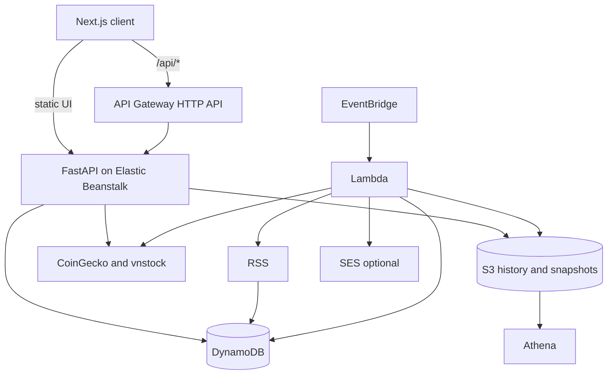

# OpenPortfo architecture

A tracker for two markets, crypto and Vietnamese stocks, in one book. Quotes are pulled when someone opens or refreshes the book, and once a day by a clock. There is no price socket. The browser never calls CoinGecko or a broker.

The design wanted the UI on S3 and CloudFront. In the lab, CloudFront was blocked, so the static export was served from Elastic Beanstalk instead. REST still goes through API Gateway. A long-lived stream, if one is used, is aimed at Beanstalk directly rather than through the HTTP API.

Lambda is only the clock: RSS ingest, a daily snapshot of the book, and an optional email. It is not the request path for a page load.

## Records

| Store    | What                                                    |
| -------- | ------------------------------------------------------- |
| DynamoDB | Users, holdings, watchlist, settings, news, price cache |
| S3       | Price history and daily snapshots                       |
| Athena   | Queries over that history                               |

External data:

- CoinGecko for crypto quotes and history.
- `vnstock` for Vietnamese stocks, server-side only. The library wraps public broker endpoints.
- RSS for news, matched by keyword to the symbols on the book.
- Exchange rates are an admin, on-demand call in the design, not a per-row fetch.

A quote is cached for minutes. A history series is stored and reused. One refresh batches the holdings instead of calling the market once per table row.

## Two ways to run the same API

`STORAGE_BACKEND=memory` and `AUTH_MODE=fake` keep the unit tests and a local demo off AWS. A token such as `fake:alice` is the local user. `STORAGE_BACKEND=aws` points the same API at DynamoDB and S3. LocalStack (`docker compose`, port 4566) stands in for those two when a developer wants the AWS adapters without an account. Tests leave `USE_AWS_ADAPTERS` unset so they stay on the fakes.

## Apps in the repo

| Path                  | Role                                                                  |
| --------------------- | --------------------------------------------------------------------- |
| `backend/`            | FastAPI, Python 3.12. This is the API.                                |
| `frontend/`           | Next.js 15, client-rendered, `lightweight-charts`, Tailwind 4, Radix. |
| `frontend-temp/`      | A small Vite viewer used while the API was the thing under test.      |
| `infra/`              | CloudFormation and the LocalStack notes.                              |
| `deploy/eb-deploy.md` | Elastic Beanstalk.                                                    |

The long design note is `docs/architecture-design.md`. It still reads as the assignment plan. The shape above is that plan, checked against `backend/requirements.txt` and `frontend/package.json`.
