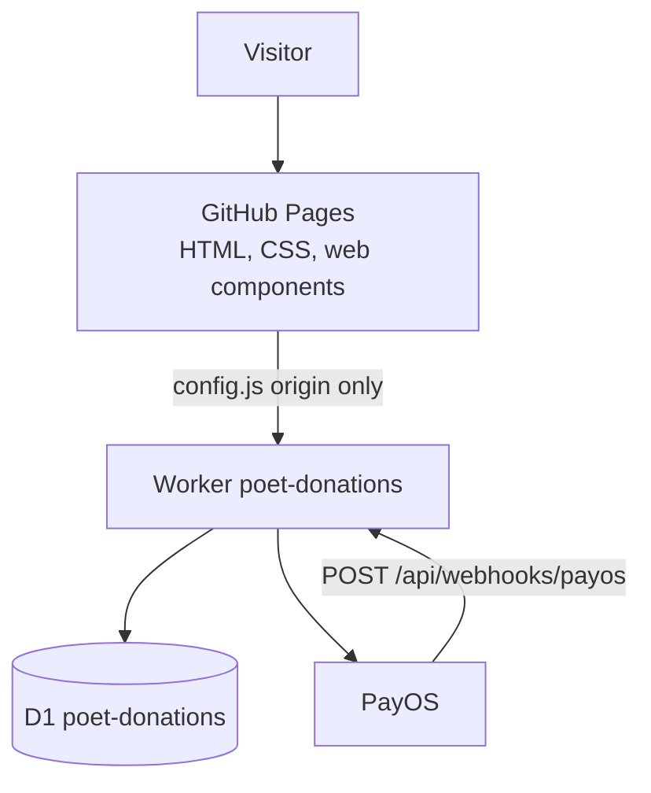

# Poet architecture

Two pieces. GitHub Pages serves the HTML. A Cloudflare Worker is the only process that talks to PayOS or to the database. The browser never decides that a gift has been paid.

`config.js` sets `window.POET_API_BASE`. The donate page, the receipt page, and the admin page read that one value. The committed origin is `https://poet-donations.lucasmai.workers.dev`. Pages are allowed from `https://maiphh.github.io` (`ALLOWED_ORIGIN`).

## Worker

`worker/src/index.js` is a router. It matches the method and the path, then calls a handler. It does not run SQL, call PayOS, or validate a body inline. CORS preflight and the origin gate for `/api/*` sit in `http.js`.

| Path                                                  | Who                                                                                 |
| ----------------------------------------------------- | ----------------------------------------------------------------------------------- |
| `POST /api/donations`                                 | Create a payment. The Worker asks PayOS for a link and stores the row.              |
| `GET /api/donations`                                  | Public wall. Published gifts only.                                                  |
| `GET /api/donations/:code`                            | Status for the receipt page.                                                        |
| `POST /api/webhooks/payos`                            | PayOS says a payment landed. Signature is checked in `payos.js`.                    |
| `POST /api/admin/login` and the admin donation routes | Session, then show, publish, or hide a gift.                                        |
| Return and cancel URLs                                | `routes-pages.js` sends the browser to the receipt. Those URLs do not write `paid`. |

Handlers live in `routes-donations.js`, `routes-webhook.js`, `routes-admin.js`, `routes-pages.js`, and `gifts.js`. `store.js` is the D1 access. `validation.js` checks the create payload. `mask.js` is how a name becomes “Ẩn danh”.

## Data

D1 table `donations`: order code, amount, display name, message, anonymous flag, status, PayOS ids, created time, paid time. A public index is `(status, paid_at)`. Admin users and sessions are separate tables. The browser does not hold the PayOS keys.

## Stack

Static HTML, CSS, and JavaScript on GitHub Pages. The Worker is Wrangler, compatibility date 2026-01-01. Checkout is PayOS. Fonts on the pages are Baloo 2, Itim, and Nunito.
